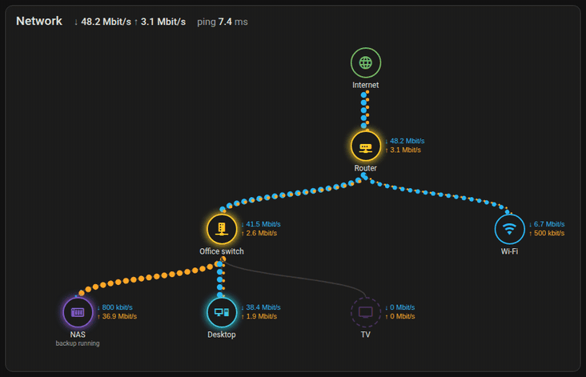
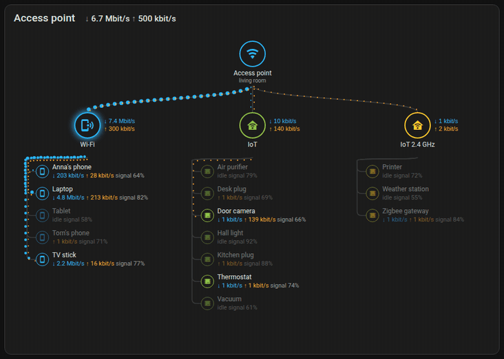
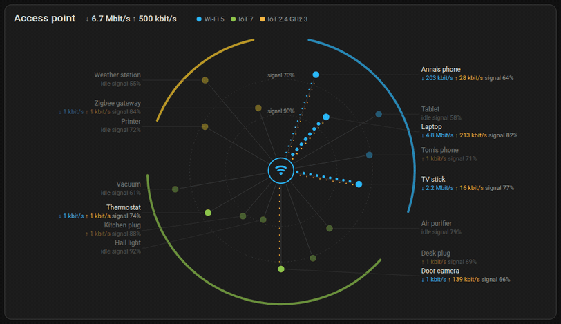
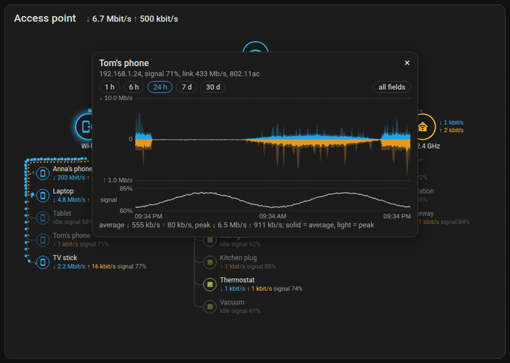

# LAN Flow Card

A Home Assistant dashboard card that draws your network as a tree, with moving dots on every cable for its live
traffic: blue towards the device, orange away from it, thicker and faster the more it carries. Wi-Fi clients can
be found automatically, and a tap on any node opens its traffic history.

No dependencies, one JavaScript file.



> Status: early. It grew out of one home network (Netgear switches, an EdgeRouter, an AmpliFi mesh). Automatic
> client discovery currently understands the AmpliFi integration only; other routers are planned (see *roadmap*).

## features

- **Tree of any depth** built from your own rate sensors: switch ports, router interfaces, a Pi's network
  interfaces, anything with a data rate. Units are converted (bit/s to GB/s, kB/s, KiB/s, ...).
- **Clients found automatically** under a node with `clients:` (AmpliFi trackers), one per line off a trunk, with
  rates and Wi-Fi signal; new devices appear by themselves.
- **Radial view** (`layout: radial`): the access point in the middle, devices around it in a sector per network, the
  stronger the signal the closer.
- **History panel** on tap: down and up (and signal for clients) over 1 h, 6 h, 24 h from the recorder, 7 and 30
  days from long-term statistics. Hover (or touch) the chart for the values at that time; drag the panel by its
  title; "all fields" lists everything the router reports for a client.
- **Phone friendly**: narrow cards switch to a compact layout.
- **Visual editor**: card options and every node in HA's card editor, with entity and icon pickers; YAML still works.

| Wi-Fi clients found automatically | radial view | history panel |
|---|---|---|
|  |  |  |

All pictures come from the demo page with made-up devices (see *demo*).

## install

### HACS (custom repository)

1. HACS > three-dot menu > Custom repositories: add `https://github.com/naqoyqatsi83/lan-flow-card`, type
   *Dashboard*.
2. Download *LAN Flow Card*, reload the browser.

### manual

1. Copy `lan-flow-card.js` to `/config/www/`.
2. Settings > Dashboards > three-dot menu > Resources: add `/local/lan-flow-card.js?v=1`, type *JavaScript
   module*. Raise `?v=` after every update, browsers cache the file.

## configuration

```yaml
type: custom:lan-flow-card
title: Network
nodes:
  - id: internet
    name: Internet
    icon: mdi:web
  - id: router
    parent: internet
    name: Router
    down: sensor.router_wan_received_rate
    up: sensor.router_wan_sent_rate
```

### card options

| option | default | meaning |
|---|---|---|
| `title` | | header title |
| `nodes` | required | list of nodes; the first one is the root |
| `latency` | | sensor in ms, shown as "ping" in the header |
| `down`, `up` | first child of the root | sensors for the header rates |
| `busy_mbit` | `5` | a node glows from this rate (down + up) |
| `idle_mbit` | `0.05` | below this a cable has no dots and a client is dimmed |
| `layout` | `tree` | `radial`: devices of all `clients` nodes around the root (cards 560 px and wider) |

### node options

| option | meaning |
|---|---|
| `id` | unique id |
| `parent` | id of the parent node (all but the root) |
| `name`, `icon`, `color` | label, `mdi:` icon, color of the circle and its dots |
| `down`, `up` | rate sensors of the cable from the parent: down = towards this node |
| `link` | sensor whose state `down` dims the node |
| `entity` | opened by the panel's *details* button (or by a tap when the node has no rate sensors) |
| `note` | fixed text under the name |
| `note_entity`, `note_attribute` | live text under the name, from an entity's state or attribute |
| `clients` | find this node's children automatically, see below |

### clients (AmpliFi)

```yaml
clients:
  prefix: 192.168.1.     # devices whose IP starts with this
  icon: mdi:cellphone
  exclude: [device_tracker.amplifi_some_device]
```

Every `device_tracker` that is `home`, has `SignalQuality` and an IP (`Address`) starting with `prefix` becomes a
child. Rates come from `RxBytes_15sec` / `TxBytes_15sec` (bytes of the last 15 s). The history panel reads the
per-device sensors made by [examples/amplifi-client-sensors-automation.yaml](examples/amplifi-client-sensors-automation.yaml).

## examples

- [examples/network-tree.yaml](examples/network-tree.yaml): a wired network.
- [examples/amplifi-clients.yaml](examples/amplifi-clients.yaml): an AmpliFi with its Wi-Fi clients.

## demo

`demo/index.html` runs the card outside Home Assistant, with made-up devices, traffic and history. Serve the repo
folder over HTTP (`python3 -m http.server`) and open `http://localhost:8000/demo/?cfg=network` (or `cfg=wifi`,
`cfg=radial`; `w=<px>` sets the width, `light=1` a light theme). `bash demo/make-gifs.sh` rebuilds the GIFs in
`docs/` from it.

## development

To try changes in your own Home Assistant next to the released card (no second instance), see
[dev/README.md](dev/README.md).

## tests

`tests/panel-keep-test.html` checks that an open panel survives the card rebuilding (a device joins or leaves).
`tests/panel-test.html` opens a client's history panel in the demo, drags it, hovers the chart and unfolds "all
fields" (look at the result). `tests/editor-test.html` checks the visual editor's logic (renaming, adding, moving, removing nodes) in a browser,
with a stand-in for HA's form: serve the repo over HTTP and open it; every line should say PASS.

## roadmap

- Client discovery for other routers (UniFi, Fritz!Box, OpenWrt, TP-Link Omada) and a generic attribute mapping.

## license

MIT, see [LICENSE](LICENSE).
